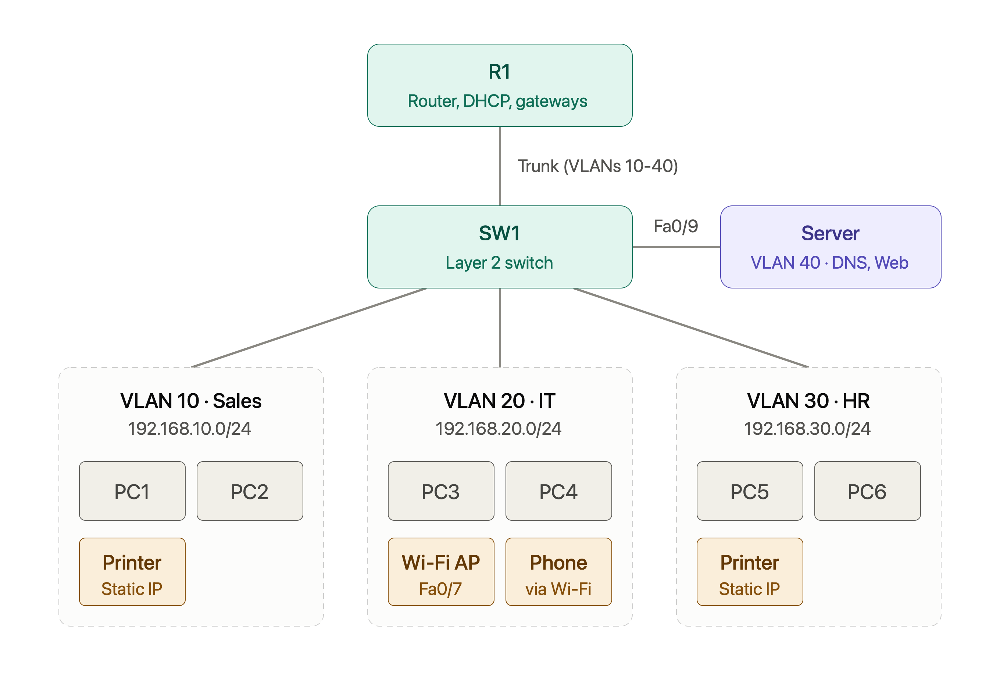
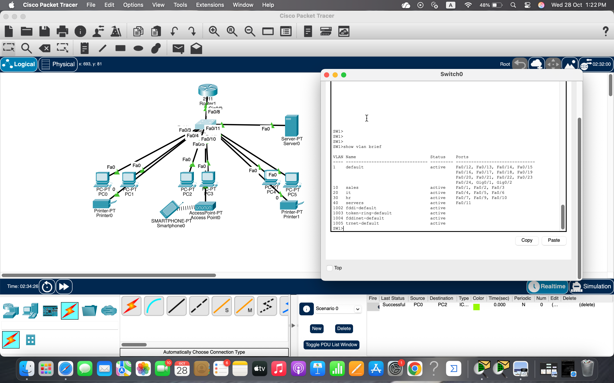
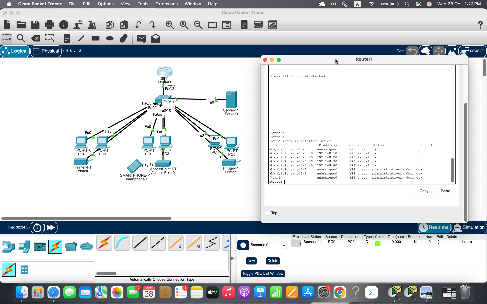
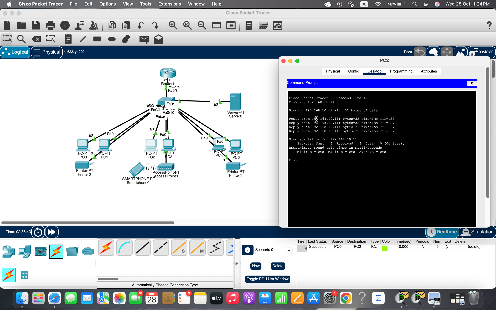
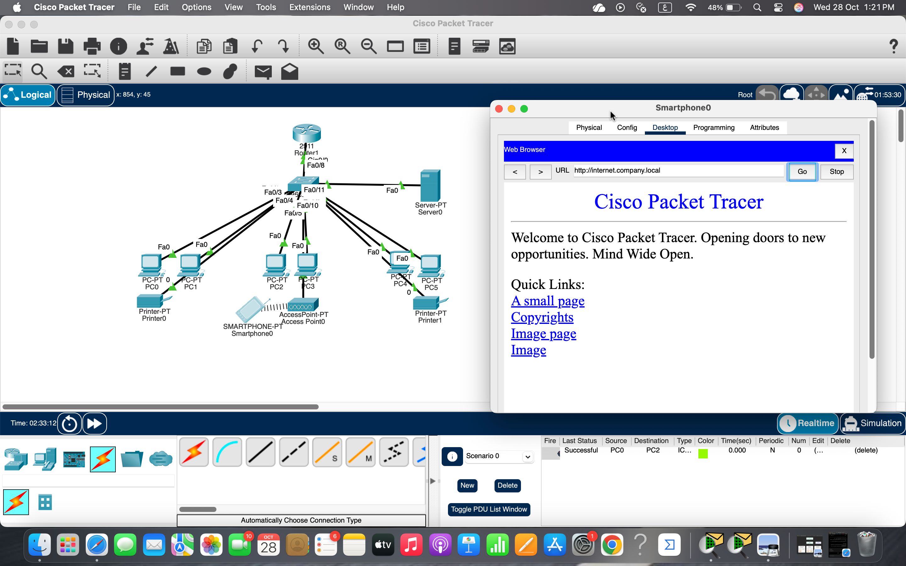

# Small Office Enterprise Network Topology

A complete Cisco Packet Tracer implementation of an enterprise small-office network featuring VLAN segmentation, Inter-VLAN routing (Router-on-a-Stick), centralized DHCP services, secure wireless connectivity, and internal network services (DNS & Web Server).

---

## 📌 Network Topology



---

## 🏗️ Architecture & Subnets Overview

| VLAN ID | Name / Department | Subnet | Key Devices | Port Allocation |
| :---: | :---: | :---: | :---: | :---: |
| **10** | Sales | `192.168.10.0/24` | PC1, PC2, Network Printer (Static IP) | FastEthernet Access Ports |
| **20** | IT | `192.168.20.0/24` | PC3, PC4, Wi-Fi AP, Smartphone | Fa0/7 (AP Access) |
| **30** | HR | `192.168.30.0/24` | PC5, PC6, Network Printer (Static IP) | FastEthernet Access Ports |
| **40** | Server Farm | Dedicated Server Subnet | DNS & HTTP Web Server | Fa0/9 (Server Access) |

---

## ⚙️ Core Technical Configurations

* **Router-on-a-Stick (R1):** Single 802.1Q trunk link carrying VLANs 10–40 between SW1 and R1 with dedicated sub-interfaces functioning as default gateways.
* **DHCP Pools:** Dynamically distributing IPv4 addressing, subnet masks, default gateways, and DNS settings per VLAN segment.
* **Wireless Infrastructure:** Cisco Access Point on VLAN 20 broadcasting SSID `Company-WiFi` with WPA2-PSK security.
* **Internal Services:** Centralized Web and DNS server hosted on VLAN 40 accessible across all subnets (`http://internet.company.local`).

---

## 📸 Verification & Screenshots

### 1. VLAN Database (`SW1`)
Active VLAN configuration, naming, and switchport assignments:


### 2. Router Sub-interfaces (`R1`)
Status and IPv4 addresses of default gateways for each VLAN:


### 3. Inter-VLAN Connectivity Test
Successful ping routing across different VLAN segments:


### 4. Wireless Client Web Portal Access
Smartphone on VLAN 20 successfully accessing the internal corporate web portal via DNS name:


---

## 🚀 How to Run
1. Download and install **Cisco Packet Tracer**.
2. Clone this repository:
   ```bash
   git clone [https://github.com/](https://github.com/)<YOUR_USERNAME>/small-office-network.git